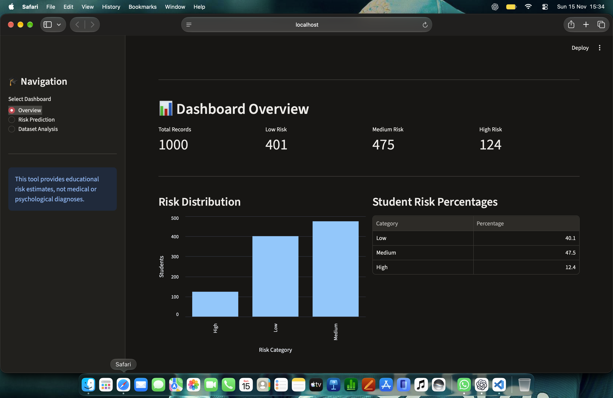
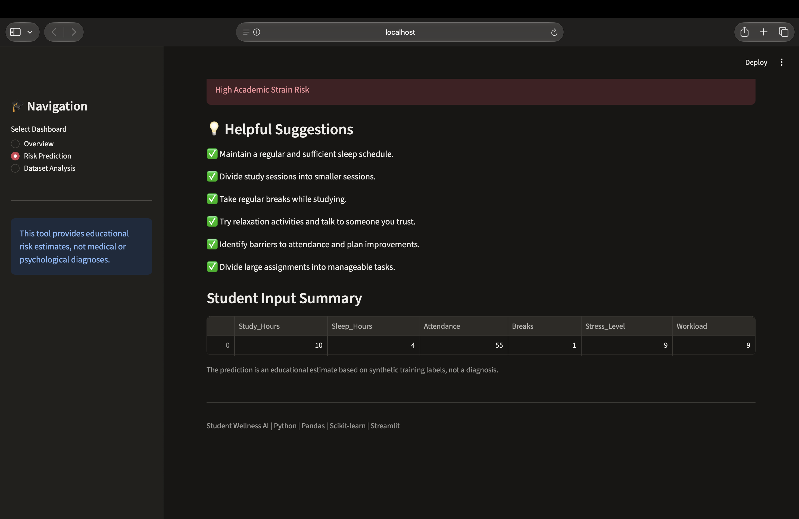
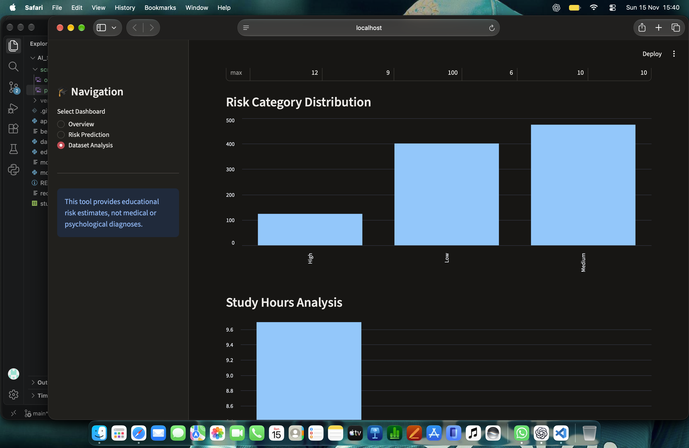

# 🎓 AI Student Burnout Early Warning System

An AI-powered educational tool designed to analyze student academic strain patterns and identify potential burnout risk levels using Machine Learning.

## 📌 Project Overview

The AI Student Burnout Early Warning System helps understand how daily study hours, sleep patterns, attendance, breaks, stress levels, and assignment workload may contribute to academic strain.

The system analyzes student-related data and predicts academic strain risk as **Low, Medium, or High**, providing helpful suggestions to encourage healthier study habits.

## 🎯 Problem Statement

Students often experience academic pressure due to excessive study hours, insufficient sleep, poor attendance, stress, and heavy assignment workloads.

This project aims to provide an early educational warning system by analyzing these factors and identifying possible academic strain patterns.

## ✨ Key Features

- Student academic strain risk prediction.
- Three risk categories: Low, Medium, and High.
- Interactive Streamlit dashboard.
- Student statistics and data visualization.
- Dataset analysis and risk distribution.
- Personalized educational suggestions based on input values.

## 🛠️ Technologies Used

- Python
- Pandas
- NumPy
- Matplotlib
- Seaborn
- Scikit-learn
- Streamlit

## 📊 Dataset Details

The project uses a synthetic dataset containing 1,000 student records.

Features include:
- Study Hours
- Sleep Hours
- Attendance Percentage
- Breaks Per Day
- Stress Level
- Assignment Workload

The risk labels are generated using predefined rules for this educational demonstration.

## 🧠 Project Workflow

1. Dataset Generation
2. Exploratory Data Analysis (EDA)
3. Data Preprocessing
4. Machine Learning Model Development
5. Model Evaluation
6. Streamlit Application Development
7. Academic Strain Risk Prediction

## 📸 Application Screenshots

### Dashboard Overview


### Student Risk Prediction


### Dataset Analysis


## ⚙️ Installation and Execution

**Step 1: Clone the repository**

```bash
git clone https://github.com/vbharathkumar894-cmd/AI-Student-Burnout-System.git
```

**Step 2: Navigate to the project folder**

```bash
cd AI-Student-Burnout-System
```

**Step 3: Create a virtual environment**

```bash
python3 -m venv venv
```

**Step 4: Activate the environment**

```bash
source venv/bin/activate
```

**Step 5: Install dependencies**

```bash
pip install -r requirements.txt
```

**Step 6: Run the application**

```bash
streamlit run app.py
```

## ⚠️ Disclaimer

This project is an educational demonstration based on synthetic data and rule-generated labels. It is not a medical or psychological diagnostic tool.

## 👩‍💻 Author

**Prasanna Papisetti**

GitHub: [AI Student Burnout System](https://github.com/vbharathkumar894-cmd/AI-Student-Burnout-System)
